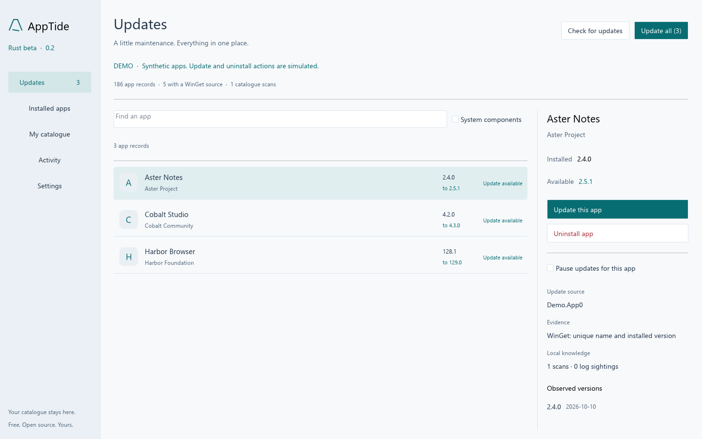
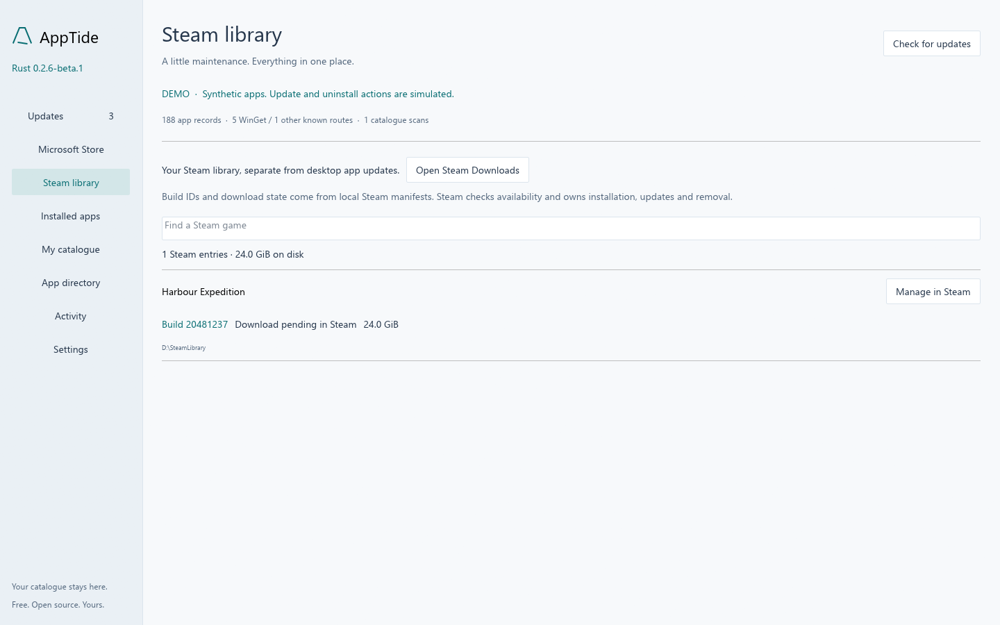
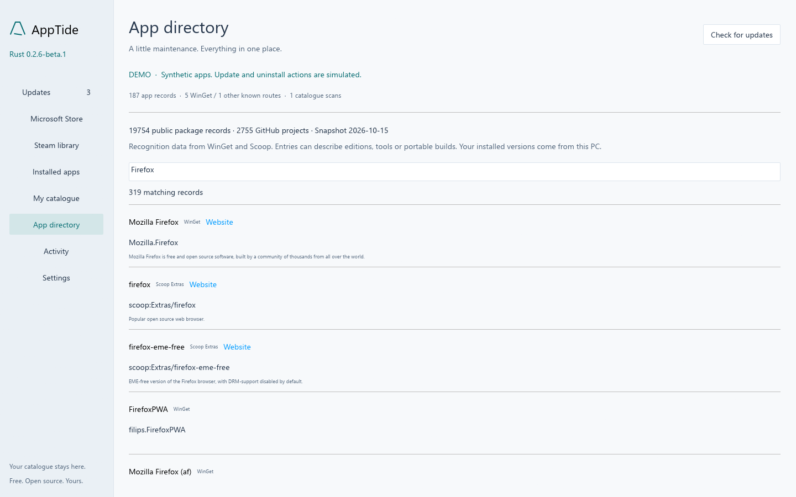
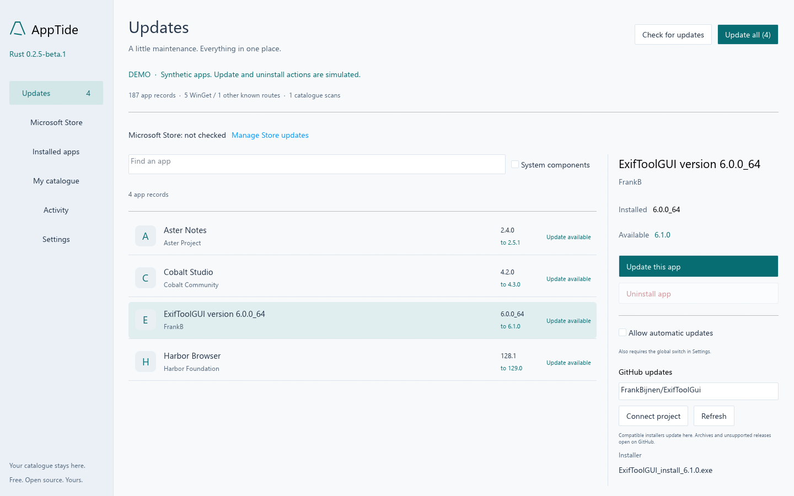
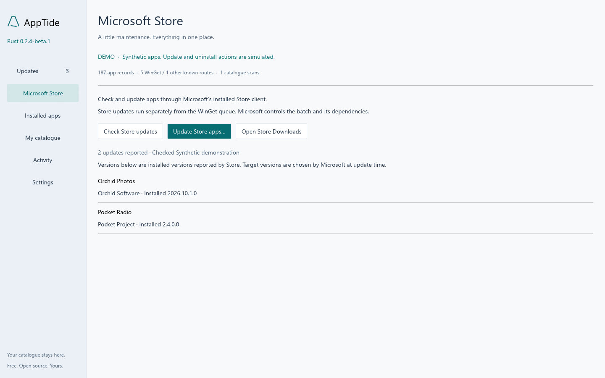
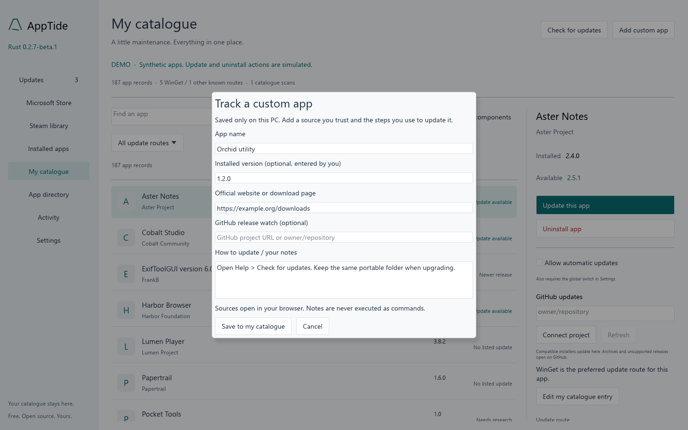

# AppTide

**Your Windows apps, updates and software catalogue in one place.**

AppTide is a free, MIT-licensed Windows software manager built in Rust. Find installed apps, update supported software together, uninstall apps, and keep a private catalogue of versions, sources and update history—even for software outside WinGet.

**[Download the Windows x64 beta](https://github.com/GitKama/AppTide/releases/download/v0.2.6-beta.1/AppTide-0.2.6-beta.1-windows-x64.zip)** · [Release notes & checksum](https://github.com/GitKama/AppTide/releases/tag/v0.2.6-beta.1) · [All releases](https://github.com/GitKama/AppTide/releases) · [Changelog](CHANGELOG.md)

Current release: **0.2.6-beta.1**. Portable, with a custom native immediate-mode interface built with egui. No Node.js, Electron or Rust installation is needed to run the downloaded app.



## Get started

1. Download the beta ZIP above and extract the **entire archive** to a writable folder.
2. Launch **`AppTide-Beta.exe`** and choose **Check for updates**.
3. Select an app to inspect its source and available actions, or preview a batch of supported updates.

The beta targets **Windows x64**. WinGet operations require Windows App Installer; supported GitHub installers use their own release assets. Release binaries are currently unsigned. Keep the packaged executable name and companion files together so AppTide can update itself.

Automatic app updates are **off by default**. Enable them in Settings and opt in each app you want managed automatically. Checks run hourly while AppTide is open; there is no installed background service or startup task.

## What AppTide does today

| Feature | Available in the Rust beta |
| --- | --- |
| Installed software inventory | Registry, current-user AppX, WinGet and chosen portable folders. Friendly Store names, readable vendors, installed versions, and local metadata fallbacks with source labels. |
| Microsoft Store updates | Check pending Store updates, review the Store batch, apply through Microsoft's installed client, and inspect logs and installed-version verification. Asynchronous batches remain pending until a later check confirms newer versions. |
| Updates and removals | Individual and batch WinGet updates, individual uninstalls, exact-package previews, fresh checks before execution, and result verification. Unmatched apps can open Windows Settings. |
| Visible action controls | Long app lists are virtualized; details scroll independently and update/uninstall controls stay visible. |
| Your own catalogue | Add manually tracked apps, maintain versions, attach official source links and GitHub projects, and save update notes. |
| Public app directory | 19,754 package records from WinGet and Scoop, with 2,755 distinct GitHub projects. Search offline; automatic associations use installed identity and publisher evidence. |
| Steam library | Separate overview of games, build IDs, local download state and disk use. Open a game or Downloads in Steam to manage updates. |
| Coverage beyond WinGet | Reviewed product/family recipes and public catalogue matches identify update routes; your own notes and sources remain private. |
| GitHub updates | Detect projects from installed metadata, reviewed recipes and the public catalogue; download compatible release installers, verify SHA256, update individually or in the shared queue, and verify the installed version. |
| Local history | Retain version observations, first/last sightings, preferences, bounded WinGet-log evidence, and verified, failed or unverified operation receipts. |
| AppTide self-updates | Check for newer AppTide releases at startup and offer an update-and-restart action with download verification and package backups. |

WinGet can recognize software installed outside WinGet, so you do not need to reinstall everything through a new package manager. Execution still requires a reliable package match. For other apps, AppTide shows an official update route, a release watch, or **Needs research** rather than guessing an installer.

## New in 0.2.6

The public **App directory** makes source discovery broader, and **Steam library** keeps game builds separate from desktop app versions. Detection now checks more local executable metadata without running it. Activity explains common installer failures, offers source refresh and an installer-prompts retry preview. Store batches can remain pending while Microsoft finishes them.

See [catalogue sources and detection rules](docs/PUBLIC-CATALOGUE.md) and [update troubleshooting](docs/UPDATE-DIAGNOSTICS.md).





## Update GitHub apps

Select a detected app, check its **GitHub updates** project, then choose **Update this app** or **Update all**. If several installers match, choose the Windows installer in the details panel first. The preview shows the project, installer and target version. Enable **Allow automatic updates** for supported recipes, plus the hourly switch in Settings, to opt in.



## Update Microsoft Store apps

Open **Microsoft Store → Check Store updates → Update Store apps…**. AppTide uses Microsoft's consumer Store CLI when available, rechecks the preview, saves output locally and verifies installed versions. The Store owns this separate bulk operation, including dependencies; AppTide's per-app pause settings do not apply. Missing client or unsupported output offers Store Downloads instead.

See [Store support, richer detection and current limitations](docs/MICROSOFT-STORE.md).



## Make the catalogue yours

Open **My catalogue → Add custom app** to track software yourself. Save its name, version, official HTTPS page, optional GitHub project and update notes. Use **Edit my catalogue entry** to maintain it later, or attach sources and notes to a detected app.



Detected names and versions remain tied to the inventory; manually tracked entries are clearly identified. **Stop tracking** retains history without uninstalling software.

The bundled recipes include routes for products such as ExifToolGUI, Meetily, Creative Cloud, NVIDIA software, Everything, browsers and game launchers. Each recipe records its public source and review date. GitHub installers now support in-app updates. Reviewed Meetily and ExifToolGUI user installations also support per-app automatic opt-in. Other compatible EXE/MSI installers use interactive setup; archives and unsupported assets remain release links. See [GitHub update support and boundaries](docs/GITHUB-UPDATES.md).

See [how the catalogue works and how to contribute recipes](docs/CATALOGUE.md).

## AppTide keeps itself up to date

At startup, AppTide checks this repository's releases in the background, including newer betas. Settings provides a manual check and an option to disable startup checks.

When a release is available, **Update AppTide and restart** verifies the download's size and SHA-256 digest, stages the package, retains the previous package files, and relaunches with the same private catalogue. Replacement failures trigger rollback. The portable folder must be writable; the updater does not request elevation.

See [self-update behavior, recovery and test coverage](docs/SELF-UPDATES.md). The current download and restart handoff have been tested separately; a complete update from the production banner to a future release remains to be validated. Hash verification does not replace publisher signing.

## Private by design

Your catalogue lives in **`%LOCALAPPDATA%\AppTide-Beta`**. Scans accumulate observations and version history; operation receipts record what could actually be verified. Catalogue saves retain a backup.

This “learning” uses structured records and reproducible rules. It requires no AI model, and log text never becomes an installer command or grants an app permission to update. Private observations are not automatically contributed to the public database.

AppTide has no telemetry and does not upload your inventory. WinGet and public GitHub checks contact their respective services. Public screenshots and test fixtures use synthetic software data.

Coming from the Electron alpha? Before the beta's first scan, **Settings → Import alpha catalogue** can copy supported data from `%LOCALAPPDATA%\AppTide` while preserving the original. Automatic-update consent is reset. See [data and migration](rust/README.md#data-and-migration).

## Troubleshooting updates

After a queue finishes or stops, AppTide shows how many apps were verified, skipped, need review or were not run. Open **Activity → View local logs** for private application events, WinGet output and batch diagnostics. Apps whose versions or permissions changed after the preview are skipped; individual failures stay recorded while unrelated apps continue. A failed verification scan, cancellation or a reboot requirement still stops the queue. See [logs and queue troubleshooting](docs/TROUBLESHOOTING.md).

## Beta boundaries

- Coverage is still growing. Some portable apps, extensions, drivers, custom installers and other users' software may be missing. Inventory counts are records and can include overlapping registrations.
- WinGet CLI parsing rejects unsupported or truncated rows. Ambiguous identities and protected components are excluded from the corresponding executable actions.
- Installers may require elevation, interaction, closed apps or a reboot. AppTide does not automatically accept installer agreements or promise unattended compatibility with every app.
- A failed or uncertain result blocks automatic retries for that app; unrelated updates continue while verification remains available. **Stop queue** lets the current installer finish; AppTide cannot roll back third-party changes.
- Automated tests simulate update and uninstall operations. Read-only live discovery and provider checks have been exercised; real third-party updates and removals have not yet been validated as part of this beta's test process.

Read the [validation record](docs/VALIDATION.md) and [roadmap](docs/ROADMAP.md) for the evidence and next milestones.

## Build and contribute

The active application is in **[`rust/`](rust/)**. On Windows x64, use Rust via rustup and the Microsoft C++ Build Tools with a Windows SDK. The repository pins its Rust toolchain in [`rust/rust-toolchain.toml`](rust/rust-toolchain.toml).

```powershell
cd rust
cargo test --locked
cargo run --locked -- --demo
cargo build --locked --release
.\target\release\apptide-beta.exe
```

Demo mode uses synthetic inventory and simulated operations. Use it for screenshots and UI work. Run `cargo fmt --check` and `cargo clippy --locked --all-targets -- -D warnings` before submitting a change.

Contributions are welcome: improve detection, add narrowly matched recipes backed by official sources, test in disposable Windows environments, or help refine the interface. Never include raw personal catalogues, installed-app lists, machine paths, credentials or installer logs in public issues or pull requests.

- [Native build instructions and implementation scope](rust/README.md)
- [Rust UI and architecture decisions](docs/RUST-BETA.md)
- [Catalogue format, sources and recipe contributions](docs/CATALOGUE.md)
- [Contribution guidelines](CONTRIBUTING.md) · [Security policy](SECURITY.md)
- [GitHub checks](https://github.com/GitKama/AppTide/actions) · [Report an issue](https://github.com/GitKama/AppTide/issues)

## Project history

AppTide began as an Electron alpha and moved to a native Rust beta in the 0.2 series. The original source, release tags, downloads and changelog remain available so the development history stays visible. The top-level Node.js application is the legacy alpha; new native development belongs in `rust/`.

[Browse all releases](https://github.com/GitKama/AppTide/releases) · [Electron alpha source and instructions](https://github.com/GitKama/AppTide/tree/v0.1.1-alpha) · [Release and versioning policy](docs/RELEASING.md)

Free and open source under the **[MIT licence](LICENSE)**.
