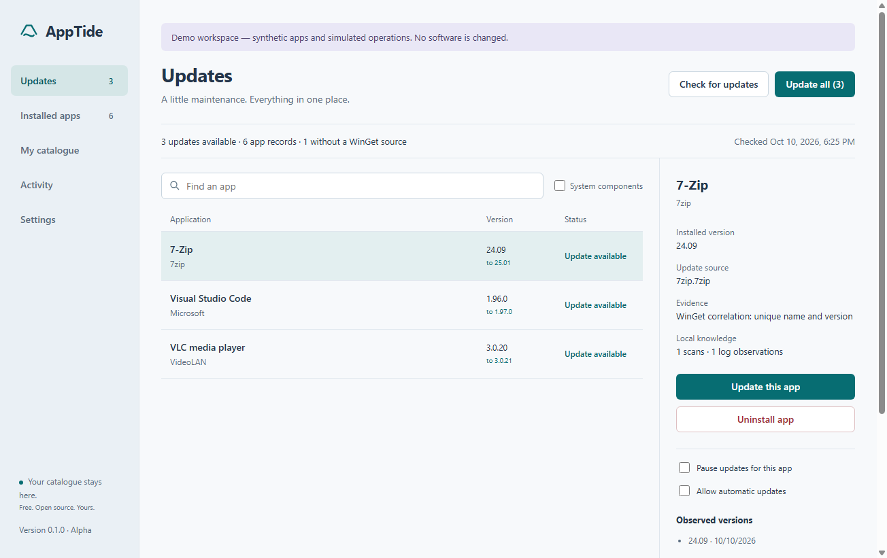

# AppTide

A free, open-source Windows software manager with a private catalogue that learns from evidence.

Find what is installed, update supported apps together, remove apps deliberately, and keep a useful history of what actually changed. AppTide starts with WinGet and makes gaps in its coverage visible.

**Status: native Rust 0.2.0-beta.1; Electron 0.1.1 alpha remains available.** Real Windows inventory and WinGet execution are implemented. This is an early software manager, not a universal updater or a promise that every installer works unattended. See [changes](CHANGELOG.md).

**Try the native Rust beta:** [AppTide 0.2.0-beta.1](https://github.com/GitKama/AppTide/releases/tag/v0.2.0-beta.1) uses a custom egui immediate-mode interface, a virtualized app list, and fixed update/uninstall controls. The portable executable has no Electron or JavaScript runtime. See [beta scope and build instructions](rust/README.md) and [research and architecture decisions](docs/RUST-BETA.md). The alpha remains available; automatic updates, portable discovery, and release-watch editing have not yet been ported to the beta.




## Electron alpha capabilities

- Inventory from machine/current-user uninstall registry records (32-bit and 64-bit), current-user AppX packages, and WinGet.
- Optional portable-folder discovery: EXE metadata, three directory levels, 500 files per folder, no symlink traversal or execution.
- WinGet updates with an exact package/version preview, serialized execution, fresh preflight, and post-operation verification.
- WinGet uninstalls with explicit confirmation. Unmatched apps have a Windows Settings fallback.
- Per-app exclusions and opt-in automatic updates, checked daily **while AppTide is open**. No background service or startup task.
- A persistent local catalogue: first/last sightings, observed versions, preferences, source coverage, and operation receipts.
- Bounded WinGet-log analysis that adds deduplicated package sightings. Logs never grant execution authority.
- Manually refreshed, watch-only GitHub release sources for custom catalogue entries. No automatic asset execution.
- A synthetic demo that exercises the interface and operation flow without changing real software.

## Run the Electron alpha

On Windows x64 with WinGet available through App Installer:

1. Download the Windows alpha ZIP from this repository's Releases, when available.
2. Extract the **entire** ZIP to a folder.
3. Run `AppTide.exe`, then **Check for updates**.

The portable distribution does not require a separate Node.js install. The alpha binary is unsigned. Keep its DLLs, resource folders, and EXE together.

To develop from source, install Node.js 22 or newer and run:

```powershell
npm ci
npm test
npm start
```

```powershell
npm run demo           # Synthetic inventory and simulated operations
npm run scan           # Read-only live scan; prints aggregate coverage
npm run test:desktop   # Synthetic Electron interaction tests and screenshots
npm run package       # Build dist/AppTide-win32-x64
```

Packaging refuses to overwrite an existing output. Set `APPTIDE_PACKAGE_OUT` to a new directory for another build. Live inventory uses the Windows PowerShell script in `scripts/inventory.ps1`. AppTide does not change execution policy; if local policy blocks the script, the scan reports the failure.

## What “learns” means

Every successful scan adds observations to a catalogue stored under `%LOCALAPPDATA%\AppTide`. WinGet-correlated identities survive registry-key changes, version history is retained, and absent records remain historical. Local WinGet logs add evidence that a package ID was seen. Operation receipts distinguish a verified result from an exit code that merely reported success.

This is deterministic evidence collection, **not an AI model**, web-wide installer discovery, or automatic trust assignment. A GitHub release watch records a source the user explicitly supplies. It does not prove that a release asset is safe, compatible, or newer than an arbitrary installed version string.

No private inventory, logs, credentials, or machine paths belong in this repository. AppTide itself has no telemetry. WinGet source requests and optional public GitHub API requests still use their providers' services.

## Limits worth understanding

- Inventory counts are records, not deduplicated counts of distinct products. Registry entries and WinGet/AppX entries may overlap.
- Some portable apps, scripts, browser extensions, game content, drivers, other users' apps, and custom installers are outside this alpha's coverage.
- WinGet CLI table parsing fails closed on unsupported or truncated rows. Structured WinGet integration is a priority.
- Only unambiguous WinGet entries are actionable. Protected components cannot be removed in AppTide.
- Installer agreements are not automatically accepted. Elevation, running apps, licensing, reboots, and installer-specific behavior can prevent unattended updates.
- “Stop queue” waits for the current installer and skips the remaining apps. AppTide does not forcibly kill installers or roll back third-party changes.
- An uncertain or failed result stops a batch and blocks unattended retry for that app. Review locally and perform a successful manual operation before retrying automatically.
- GitHub release watches are refreshed manually in this alpha. They are not an alternate installation provider yet.
- Public demo screenshots and tests use synthetic software data. No real app update or removal was used to validate this initial release.

See [research](docs/RESEARCH.md), [architecture](docs/ARCHITECTURE.md), [roadmap](docs/ROADMAP.md), and [validation](docs/VALIDATION.md). Contributions are welcome under the [MIT licence](LICENSE).
